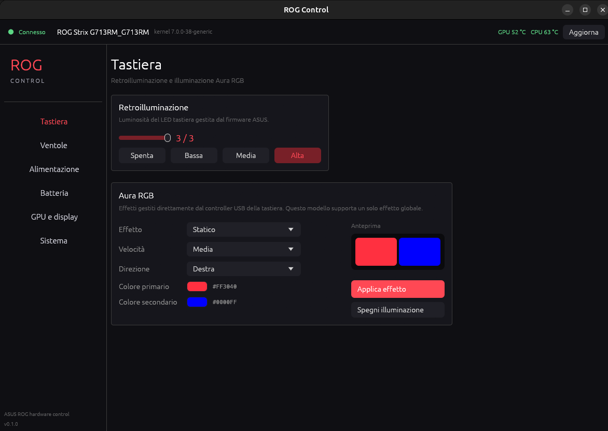

# ROG Control

Rust (egui) application + root daemon for controlling ASUS ROG laptop hardware.
Designed and verified on a **ROG Strix G713RM** (G17 2022, AMD Ryzen 7 6800H + RTX 3060),
but it relies on standard interfaces (`asus-wmi`, `asus-armoury`, `asus_custom_fan_curve`,
ACPI, hidraw), so it works on many ROG/Strix models.



## Features

- **Keyboard**
  - Backlight brightness (0–3) via `/sys/class/leds/asus::kbd_backlight`.
  - **Aura RGB** via hidraw (`0b05:19b6`): static, breathe, rainbow cycle/wave, stars,
    rain, highlight, laser, ripple, pulse, comet, flash; primary and secondary colour,
    speed and direction. Global effect only (this controller does not support the four
    zones independently).
- **Fans**
  - RPM and temperature for CPU and GPU.
  - Custom 8-point curve per fan, with chart and validation.
  - Return to the BIOS automatic mode.
- **Power**
  - ACPI profiles: quiet / balanced / performance.
  - CPU Boost (amd-pstate).
- **Battery**
  - Percentage, status and power draw in watts.
  - Charge limit (40–100%).
- **GPU and display**
  - Panel brightness.
  - Panel Overdrive and boot sound.
  - dGPU off and Hybrid/Ultimate mux mode (with confirmation and reboot).
- **System**
  - Model, kernel, distro, uptime, load, governor.
  - All hwmon sensors and NVIDIA statistics (`nvidia-smi`).

## Architecture

```
┌────────────────────┐   JSON over Unix socket  ┌──────────────────────────┐
│  rog-control (GUI) │ ───────────────────────► │ rog-control-daemon (root)│
│  user, egui        │ ◄─────────────────────── │  sysfs / hwmon / hidraw  │
└────────────────────┘   /run/rog-control/...   └──────────────────────────┘
```

The GUI does not run as root. The daemon only exposes explicit, validated commands
(no arbitrary paths), and the socket is accessible to the `plugdev` group with
`0660` permissions.

## Installation

Requirements: Rust (stable), `systemd`, an X11/Wayland desktop environment.

```bash
cd rog-control
./install.sh
```

The script builds the project, installs the binaries in `/usr/local/bin`, the
`rog-control-daemon.service` unit, the desktop entry and the icon, then starts
the daemon.

Start the GUI manually:

```bash
rog-control
```

## Security

- The daemon runs as root but does not accept arbitrary paths: every command is
  typed and validated.
- The socket is `0660 root:plugdev`. If the group does not exist, the daemon warns
  and falls back to `0666` (single-user environment).
- dGPU/mux changes always require confirmation in the GUI and a reboot.

## Technical notes

- The Aura effect cannot be read back from the controller (the 0x5e handshake
  returns invalid data). The last applied effect is therefore saved to
  `/var/lib/rog-control/aura.json`, shown by the GUI and reapplied by the daemon
  at startup (with a few retries, since the controller is a USB device).
- Aura packets are the same ones used by `asusctl`: `5d b3` (effect), `5d b5`
  (set), `5d b4` (apply), sent as 64-byte reports.
- PPT limits (`ppt_pl1_spl`, …) return `ENODEV` on this firmware: the section is
  therefore informational and control remains with the ACPI profiles.
- Fan curves use `pwmN_enable=1` (custom) / `2` (BIOS auto), with 8 increasing
  temperature/PWM points.

## Uninstall

```bash
sudo systemctl disable --now rog-control-daemon.service
sudo rm -f /etc/systemd/system/rog-control-daemon.service \
           /usr/local/bin/rog-control /usr/local/bin/rog-control-daemon \
           /usr/share/applications/rog-control.desktop
sudo rm -f /usr/share/icons/hicolor/*/apps/rog-control.png
sudo rm -rf /var/lib/rog-control
sudo systemctl daemon-reload
```

## Credits

- **Archivo Black** font, SIL Open Font License 1.1 (`assets/OFL.txt`).
- Aura packet layout documented by the [asusctl](https://gitlab.com/asus-linux/asusctl) project (MPL-2.0).
